<a name="top"></a>

<p align="center">
  <picture>
    <source media="(prefers-color-scheme: dark)" srcset="docs/assets/cendaro-logo-dark.png" />
    <source media="(prefers-color-scheme: light)" srcset="docs/assets/cendaro-logo-light.png" />
    
  </picture>
</p>

<p align="center">
  <strong>Enterprise-Grade Omnichannel ERP for Wholesale, Import &amp; Retail Commerce</strong><br/>
  Multi-warehouse inventory · Dual-currency treasury (USD / Bs · BCV) · AI packing-list ingestion · Fiscal &amp; POS operations · Multi-tenant RLS isolation
</p>

<p align="center">
  <a href="https://github.com/jesusjosezapata99-jpg/Cendaro/actions/workflows/ci.yml"></a>
  <a href="https://github.com/jesusjosezapata99-jpg/Cendaro/actions/workflows/codeql.yml"></a>
  
  
  
  
  
  
  
  
  <a href="LICENSE"></a>
</p>

<p align="center">
  <a href="#-product-tour">Product Tour</a> ·
  <a href="#-architecture">Architecture</a> ·
  <a href="#-tech-stack">Tech Stack</a> ·
  <a href="#-monorepo-packages">Packages</a> ·
  <a href="#-erp-modules">ERP Modules</a> ·
  <a href="#-database-schema">Database</a> ·
  <a href="#-ai-pipeline">AI Pipeline</a> ·
  <a href="#-security">Security</a> ·
  <a href="#-design-system">Design System</a> ·
  <a href="#-getting-started">Quickstart</a> ·
  <a href="#-documentation">Docs</a>
</p>

<br/>

<p align="center">
  <picture>
    <source media="(prefers-color-scheme: dark)" srcset="docs/assets/showcase/dashboard-dark.png" />
    <source media="(prefers-color-scheme: light)" srcset="docs/assets/showcase/dashboard-light.png" />
    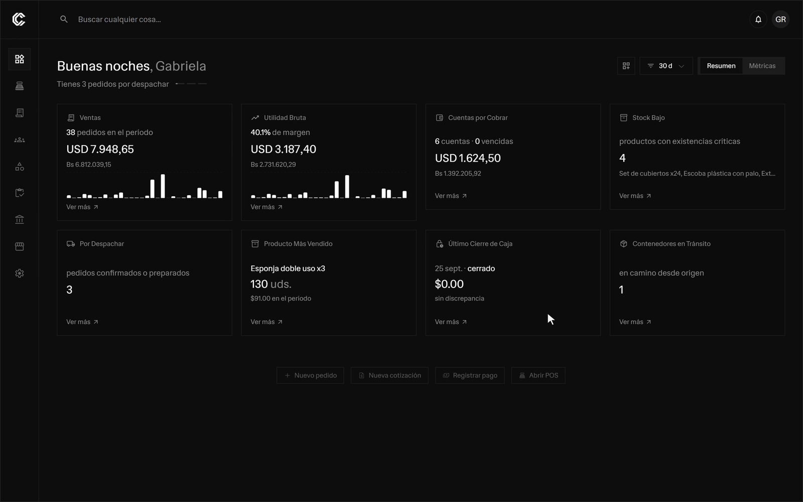
  </picture>
</p>

<p align="center">
  <sub><strong>Executive Control Plane</strong> — Real-time sales velocity, gross margin analytics, accounts receivable aging, low-stock telemetry, and global command search (<kbd>⌘K</kbd> / <kbd>Ctrl+K</kbd>). Automatically renders in Light or Dark mode to match your GitHub appearance settings.</sub>
</p>

<br/>

---

## ⚡ Executive Summary

**Cendaro** is a production-grade, multi-tenant omnichannel ERP engineered specifically for high-volume importers, wholesale distributors, and multi-branch retailers operating in bi-currency economies (**USD** and **VES / Bs** with daily **BCV** central bank synchronization).

Built as a strictly typed **pnpm + Turborepo** monorepo on **Next.js 16 (App Router)**, **React 19**, **tRPC v11**, **Drizzle ORM**, and **Supabase PostgreSQL**, Cendaro replaces fragmented spreadsheets and legacy desktop accounting software with a single, cryptographically audited operational backbone.

| Pillar                        | Architectural Capability                                                                                                                                                                                                   | Verification & Enforcement                                                                                                                           |
| :---------------------------- | :------------------------------------------------------------------------------------------------------------------------------------------------------------------------------------------------------------------------- | :--------------------------------------------------------------------------------------------------------------------------------------------------- |
| **Omnichannel Core**          | **18 domain modules** across **23 authenticated route groups** unifying catalog, multi-warehouse stock, containers, POS, sales orders, quotes, AR aging, and vendor portals.                                               | Enforced via [`ERP_MODULES`](packages/validators/src/authz.ts) and verified by automated smoke & role-matrix guards.                                 |
| **Bi-Currency Treasury**      | USD base pricing with real-time VES (Bolívares) settlement, automated daily **BCV** & **USD/CNY** exchange rate ingestion, spread analytics, and **≥ 5% deviation preventive holds**.                                      | Validated in [`packages/api/src/modules/pricing.ts`](packages/api/src/modules/pricing.ts) & [`rate-sync.ts`](packages/api/src/modules/rate-sync.ts). |
| **AI Container Ingestion**    | 3-tier pipeline parsing **130 MB+ Excel/PDF packing lists** (including embedded product photos), translating supplier manifests into Spanish, and matching SKUs against catalog history.                                   | Powered by client-side SheetJS extraction + Groq LPU (`Qwen3-32B` & `Llama 4 Scout`).                                                                |
| **Defense-in-Depth Security** | **7 security layers**: Supabase SSR Auth, mandatory **MFA/TOTP (`aal2`)** for privileged roles, Cloudflare Turnstile, 6-role RBAC builders, PostgreSQL **Restrictive RLS**, and a **SHA-256 hash-chained WORM audit log**. | Enforced in CI by `procedure-authz-coverage.test.ts`, `CodeQL`, and `ecc-agentshield`.                                                               |
| **0-Radius Monochrome UI**    | Precision editorial interface inspired by Midday (`--radius: 0rem`), **Hedvig Letters Sans/Serif** + **Geist Mono** tabular numerals (`tnum`), and WCAG AA semantic status tokens.                                         | Validated on every commit by [`design-guard.mjs`](scripts/checks/design-guard.mjs) and [`contrast.mjs`](scripts/checks/contrast.mjs).                |

---

## 📋 Table of Contents

- [⚡ Executive Summary](#-executive-summary)
- [🖥 Product Tour (Light & Dark Adaptive Showcase)](#-product-tour)
- [🏗 Architecture](#-architecture)
  - [System Overview](#system-overview)
  - [Request Lifecycle & Read/Write RLS Isolation](#request-lifecycle)
  - [Monorepo File Tree](#monorepo-file-tree)
- [⚡ Tech Stack](#-tech-stack)
- [📦 Monorepo Packages](#-monorepo-packages)
  - [`@cendaro/api` — Business Logic & 22 tRPC Routers](#cendaroapi--business-logic-layer)
  - [`@cendaro/db` — Drizzle ORM, 75 Tables & Supavisor Pool](#cendarodb--database--schema)
  - [`@cendaro/auth` — Multi-Runtime Supabase SSR Auth](#cendaroauth--authentication)
  - [`@cendaro/ui` — 0-Radius Component System & 154 Icons](#cendaroui--component-library)
  - [`@cendaro/validators` — Domain Schemas & RBAC Matrix](#cendarovalidators--domain-validation)
- [🧭 ERP Modules & AI Search (GEO) Surface](#-erp-modules)
- [🗄 Database Schema (75 Tables · 37 Enums · 50 Migrations)](#-database-schema)
- [🤖 AI Container & Document Pipeline](#-ai-pipeline)
- [🔐 7-Layer Enterprise Security Model](#-security)
- [🎨 Design System (Monochrome 0-Radius Architecture)](#-design-system)
- [🚀 Getting Started](#-getting-started)
  - [Prerequisites & Quickstart](#prerequisites--installation)
  - [Environment Variables Reference](#environment-variables)
  - [Workspace Scripts & CI Quality Gates](#-scripts)
- [🗺 Roadmap & Maturity](#-roadmap)
- [📄 Canonical Documentation & Compliance Index](#-documentation)
- [⚖️ License](#-license)

---

## 🖥 Product Tour

> [!TIP]
> **Adaptive Theme Previews:** Every product capture below uses standard HTML5 `<picture>` media queries (`prefers-color-scheme: dark` and `prefers-color-scheme: light`). Switch your GitHub appearance between **Light** and **Dark** mode on desktop or mobile to inspect both themes natively.

### 1. AI-Assisted Container & Packing List Ingestion (`/containers`)

Upload raw supplier packing lists in Excel (`.xlsx`, `.xls`) or PDF—even with Mandarin/English descriptions and embedded images. Cendaro extracts line items in the browser, translates commercial descriptions, computes landed FOB costs in USD and BCV Bolívares, and scores SKU affinity against your catalog before stock commitment.

<p align="center">
  <picture>
    <source media="(prefers-color-scheme: dark)" srcset="docs/assets/showcase/container-ai-dark.png" />
    <source media="(prefers-color-scheme: light)" srcset="docs/assets/showcase/container-ai-light.png" />
    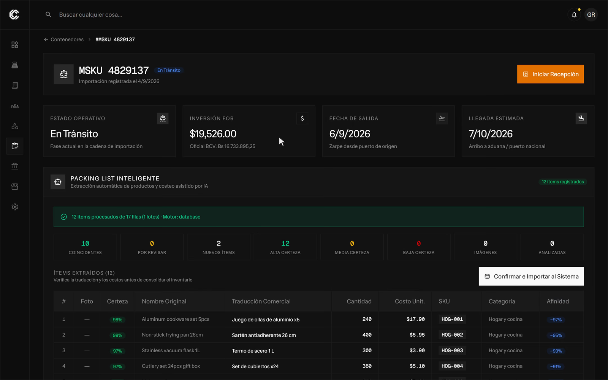
  </picture>
</p>

### 2. Bi-Currency Treasury, BCV Sync & Spread Intelligence (`/rates`)

Centralized foreign-exchange desk tracking official **BCV (USD/VES)**, parallel market reference, and **RMB/USD (CNY)** rates with automated daily synchronization, exchange-gap telemetry, a live multi-currency conversion calculator, and preventive repricing holds when rate volatility exceeds **5%**.

<p align="center">
  <picture>
    <source media="(prefers-color-scheme: dark)" srcset="docs/assets/showcase/rates-bcv-dark.png" />
    <source media="(prefers-color-scheme: light)" srcset="docs/assets/showcase/rates-bcv-light.png" />
    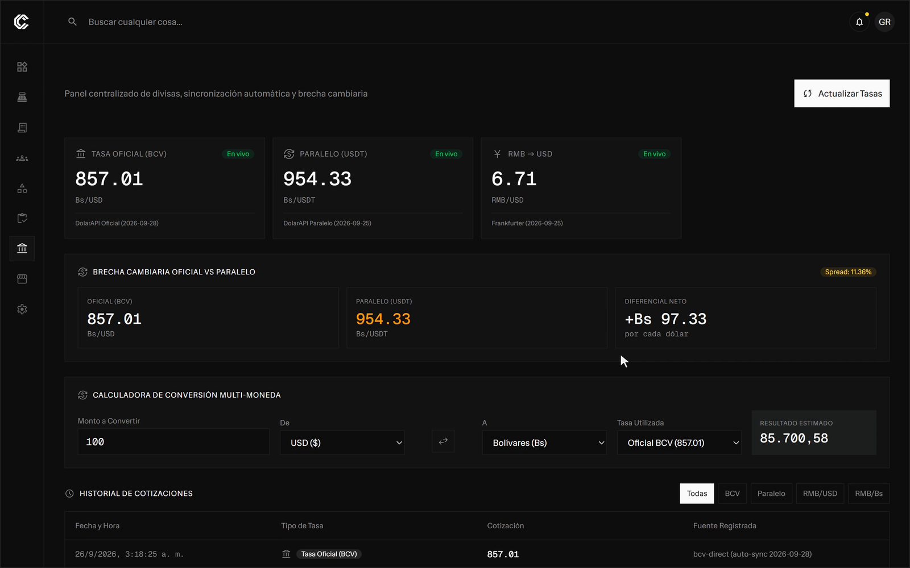
  </picture>
</p>

### 3. Multi-Warehouse & Omnichannel Inventory Control (`/inventory`)

Real-time stock ledger across physical warehouses, retail storefronts, in-transit maritime containers, Mercado Libre allocations, and field sales force quotas—backed by double-entry stock movement trails, inter-warehouse transfers, and blind cycle counts.

<p align="center">
  <picture>
    <source media="(prefers-color-scheme: dark)" srcset="docs/assets/showcase/inventory-stock-dark.png" />
    <source media="(prefers-color-scheme: light)" srcset="docs/assets/showcase/inventory-stock-light.png" />
    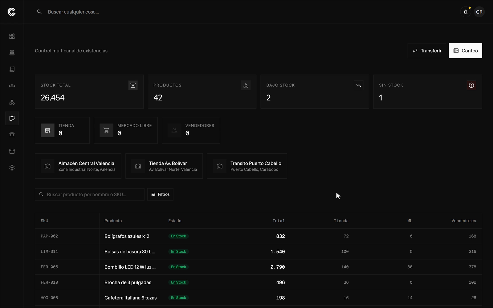
  </picture>
</p>

<details>
<summary><strong>🔎 View Commercial Order Lifecycle &amp; Accounts Receivable Reconciliation Captures (<code>/orders</code> &amp; <code>/accounts-receivable</code>)</strong></summary>
<br/>

#### Omnichannel Sales Orders & Dual-Currency Billing (`/orders`)

End-to-end order orchestration across POS counter sales, WhatsApp assisted commerce, field vendors, and Mercado Libre—displaying line-item breakdowns, tax profiles, dispatch notes, and simultaneous USD / Bs settlement balances.

<p align="center">
  <picture>
    <source media="(prefers-color-scheme: dark)" srcset="docs/assets/showcase/orders-sale-dark.png" />
    <source media="(prefers-color-scheme: light)" srcset="docs/assets/showcase/orders-sale-light.png" />
    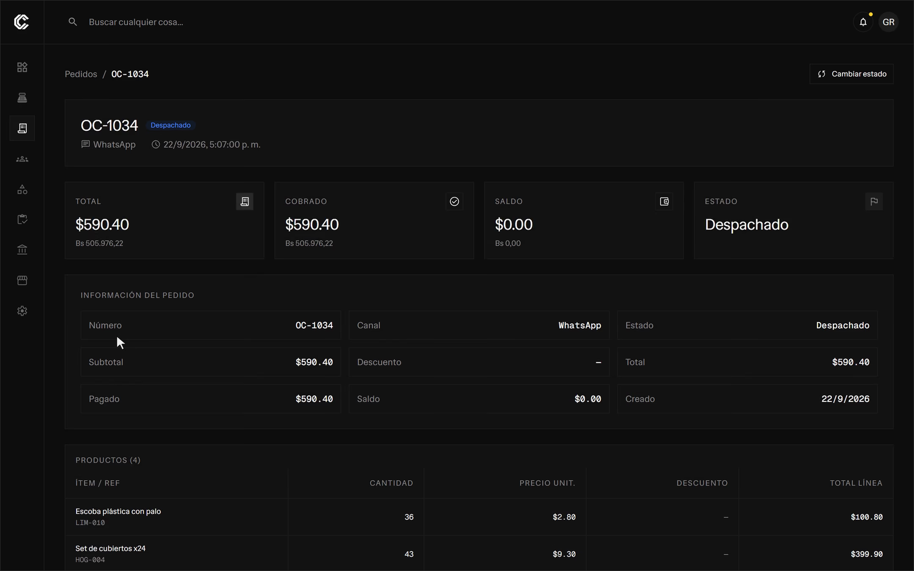
  </picture>
</p>

#### Accounts Receivable Aging & BCV-Indexed Installments (`/accounts-receivable`)

Granular credit portfolio management with aging buckets (current, 1–30, 31–60, 60+ days), partial payment allocation across payment methods (Pago Móvil, Wire Transfer, Zelle, Cash USD/Bs), and instant BCV conversion at settlement time.

<p align="center">
  <picture>
    <source media="(prefers-color-scheme: dark)" srcset="docs/assets/showcase/receivables-close-dark.png" />
    <source media="(prefers-color-scheme: light)" srcset="docs/assets/showcase/receivables-close-light.png" />
    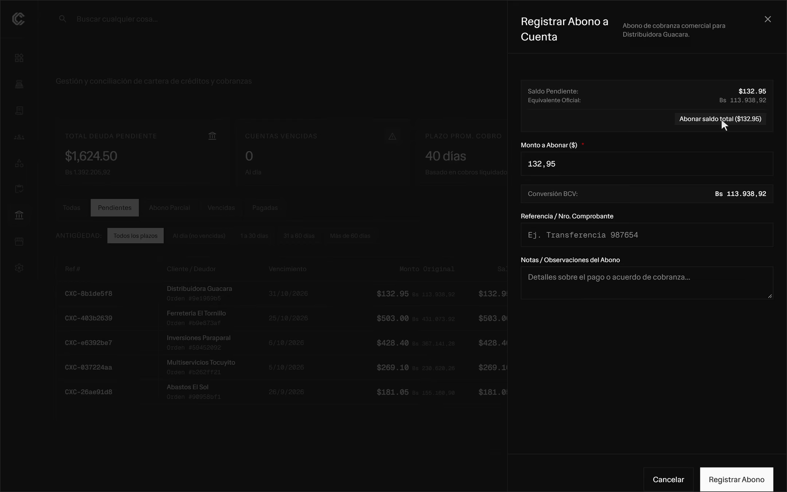
  </picture>
</p>

</details>

<p align="right"><a href="#top">↑ Back to top</a></p>

---

## 🏗 Architecture

### System Overview

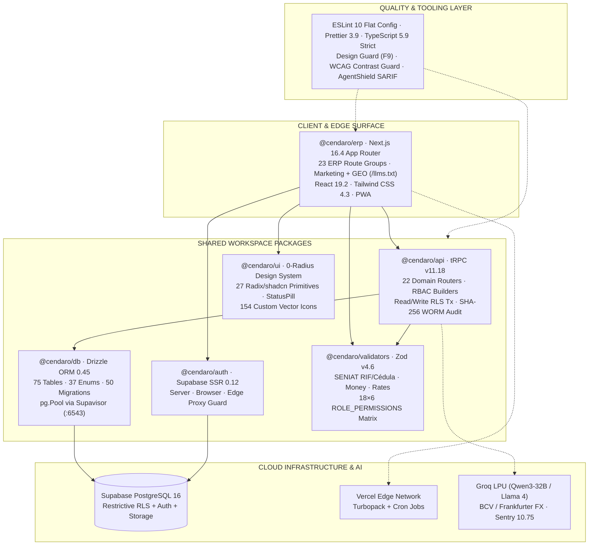

### Request Lifecycle

Every request traverses a deterministic multi-layer security and data-isolation pipeline. Read procedures execute inside `SET TRANSACTION READ ONLY` with tenant-scoped PostgreSQL configuration parameters, while mutations enforce role-based action permissions and append cryptographic audit records.

```mermaid
sequenceDiagram
  autonumber
  actor U as Browser / PWA
  participant P as Edge Proxy Guard
  participant N as Next.js 16 RSC
  participant T as tRPC v11 Authz
  participant D as Drizzle + pg.Pool
  participant S as Supabase Postgres 16

  U->>+P: HTTPS Request (Cookie + x-workspace-id)
  P->>P: Verify Supabase SSR Session & Idle Timeout (30m)
  alt Unauthenticated or Expired
    P-->>U: 302 Redirect -> /login?expired=1
  else Owner/Admin without AAL2 (MFA)
    P-->>U: 302 Redirect -> /login/mfa
  end

  P->>+N: Authenticated Request Context
  N->>+T: Invoke Procedure (Caller / HTTP Batch)
  T->>T: Validate RFC 4122 workspaceId & workspace_member Role
  T->>T: Check meta.authz (ROLE_PERMISSIONS & WorkspaceModule)
  alt Unauthorized Role or Disabled Module
    T-->>N: 403 FORBIDDEN
  end

  T->>+D: Open Scoped Transaction (Read-Only or Read-Write)
  D->>+S: SET LOCAL ROLE app_user; SET LOCAL app.workspace_id = '<uuid>';
  D->>S: Parameterized SQL Query (Restrictive RLS Active)
  S-->>-D: Tenant-Isolated Rows
  opt Auditable Mutation
    D->>S: INSERT audit_log (prev_hash + SHA-256 chain_hash)
  end
  D-->>-T: Strictly Typed Result
  T-->>-N: SuperJSON Serialized Payload
  N-->>-P: Streamed RSC / HTML Response
  P-->>-U: Hydrated UI
```

### Monorepo File Tree

```text
cendaro/
├── apps/
│   └── erp/                                  # @cendaro/erp — Next.js 16.4 App Router application
│       ├── public/                           # PWA manifest, icons & HiDPI AV1/WebM/AVIF landing media
│       └── src/
│           ├── app/(app)/                    # 23 authenticated ERP route groups (Midday 0-radius shell)
│           ├── app/(marketing)/              # Public marketing site & feature deep-dives (/funciones/[slug])
│           ├── app/api/                      # tRPC handler, Auth routes (Login/MFA/Logout), AI & Cron endpoints
│           ├── app/llms.txt & llms-full.txt/ # Dynamic Markdown knowledge bases for AI search engines (GEO)
│           ├── components/                   # App shell (Sidebar, TopBar, CommandSearch, NotificationCenter)
│           ├── hooks/                        # useWorkspace, useCurrentUser, useBcvRate, useCnyRate, useDebounce
│           ├── lib/                          # Status tokens, RBAC route guards, rate-limiter, SEO/IndexNow
│           ├── modules/                      # Domain UI modules (catalog, inventory, pos, sales, fiscal, etc.)
│           ├── trpc/                         # TanStack Query v5 + tRPC v11 client/server hydration
│           ├── env.ts                        # @t3-oss/env-nextjs + Zod v4 runtime environment contract
│           └── proxy.ts                      # Edge session, idle-timeout & AAL2 MFA enforcement guard
│
├── packages/
│   ├── api/                                  # @cendaro/api — tRPC v11 business logic layer
│   │   └── src/
│   │       ├── modules/                      # 22 domain routers + integration & unit test suites
│   │       ├── services/                     # MFA enforcement, WORM audit chain, financial reconciliation
│   │       ├── logger.ts                     # Structured PII-redacting server logger
│   │       ├── root.ts                       # Unified appRouter & AppRouter type export
│   │       └── trpc.ts                       # Authz procedure builders & RLS transaction runners
│   ├── auth/                                 # @cendaro/auth — Supabase SSR (server, client, middleware)
│   ├── db/                                   # @cendaro/db — Drizzle ORM schema (75 tables, 37 enums)
│   │   ├── migrations/                       # 50 sequential SQL migrations + RLS & trigger definitions
│   │   └── src/                              # schema.ts, relations.ts, client.ts (Supavisor pg.Pool)
│   ├── ui/                                   # @cendaro/ui — 27 shadcn/Radix primitives, StatusPill, 154 icons
│   └── validators/                           # @cendaro/validators — Zod v4 schemas & 18×6 RBAC permission matrix
│
├── tooling/
│   ├── eslint/                               # ESLint 10 flat configs (base, react, nextjs)
│   ├── prettier/                             # Prettier 3.9 + import sorting + Tailwind class sorting
│   ├── tailwind/                             # Tailwind CSS v4 theme.css (monochrome + WCAG AA status tokens)
│   └── typescript/                           # Strict ES2024 TSConfigs (noUncheckedIndexedAccess)
│
├── scripts/
│   ├── checks/                               # CI guards: design-guard, contrast, role-matrix, smoke-routes
│   ├── landing-media/                        # Playwright + FFmpeg HiDPI video/poster capture pipeline
│   ├── seed/                                 # Deterministic audit dataset seeder & unseeder
│   └── seo/                                  # IndexNow, WebSub & Google Search Console deployment ping
│
├── docs/                                     # Canonical PRD v1/v2, ERD, DBML, ADRs & SOC2/ISO policies
├── plans/                                    # Engineering execution plans & security/performance audit reports
├── turbo.json                                # Turborepo v2.10 pipeline orchestration
└── pnpm-workspace.yaml                       # Workspace topology, dependency catalogs & 24h release quarantine
```

<p align="right"><a href="#top">↑ Back to top</a></p>

---

## ⚡ Tech Stack

> [!NOTE]
> **Centralized Catalog & Supply-Chain Quarantine:** All dependency versions are pinned via `catalog:` and `catalogs.react19` in [`pnpm-workspace.yaml`](pnpm-workspace.yaml). To mitigate supply-chain compromises, `minimumReleaseAge: 1440` enforces a mandatory 24-hour quarantine on newly published npm packages before lockfile resolution.

### Frontend, Backend, Data & Quality Stack

| Layer                    | Technology                                     | Version                         | Role in Cendaro ERP                                                                              |
| :----------------------- | :--------------------------------------------- | :------------------------------ | :----------------------------------------------------------------------------------------------- |
| **Framework**            | **Next.js** (App Router)                       | `^16.4.3`                       | React Server Components (RSC), Turbopack dev server, dynamic OG generation, edge proxy.          |
| **UI Runtime**           | **React** & **React DOM**                      | `19.2.8`                        | Concurrent UI rendering, Server Actions, strict DOM attribute validation.                        |
| **Language**             | **TypeScript**                                 | `^5.9.3`                        | Strict mode (`noUncheckedIndexedAccess`, zero `any`), ES2024 target, bundler resolution.         |
| **Styling**              | **Tailwind CSS**                               | `^4.3.3`                        | CSS-first `@theme inline` token system via `@tailwindcss/postcss`.                               |
| **Component Primitives** | **Radix UI** + **shadcn/ui**                   | `^1.6.7`                        | 27 accessible, unstyled-first primitives customized to Cendaro's 0-radius design language.       |
| **Motion**               | **Framer Motion**                              | `^13.1.0`                       | Tree-shaken `<LazyMotion strict>` animations (`m.*` proxy components).                           |
| **API Transport**        | **tRPC** (`server` / `client` / `rq`)          | `^11.18.0`                      | End-to-end type-safe RPC with `superjson` (`2.2.6`) serialization and RBAC metadata.             |
| **Server State**         | **TanStack Query**                             | `^5.102.8`                      | Declarative caching, optimistic mutations, and SSR hydration.                                    |
| **Data Grids**           | **TanStack Table** & **Virtual**               | `^8.21.3` / `^3.14.10`          | High-density sortable tables and 60fps virtualized scrolling for large catalogs.                 |
| **URL State**            | **nuqs**                                       | `2.10.1`                        | Type-safe URL search parameter state synchronization.                                            |
| **ORM & Migrations**     | **Drizzle ORM** & **Drizzle Kit**              | `^0.45.2` / `^0.31.10`          | Type-safe SQL builder, relational queries, and 50 versioned SQL migrations.                      |
| **Database Driver**      | **pg** (`node-postgres`)                       | `^8.23.0`                       | Connection `Pool` (max 5/instance) routed through Supabase Supavisor transaction mode (`:6543`). |
| **Auth & Storage**       | **Supabase JS** & **SSR**                      | `^2.114.0` / `^0.12.5`          | Cookie-based SSR sessions, TOTP MFA (`aal2`), and object storage for packing list media.         |
| **Validation**           | **Zod v4** (`zod/v4`)                          | `^4.6.7`                        | Runtime validation for tRPC inputs, environment variables, and Venezuelan fiscal formats.        |
| **File Processing**      | **SheetJS (`xlsx`)**, **pdf-parse**, **sharp** | `0.20.3` / `^2.4.5` / `^0.35.5` | Pinned CDN tarball spreadsheet parser, PDF text extraction, and native image processing.         |
| **Testing**              | **Vitest**                                     | `^4.1.12`                       | Unit, integration, RBAC coverage, and marketing truth-guard test suites.                         |
| **Monorepo &Pkg**        | **Turborepo** & **pnpm**                       | `^2.10.12` / `10.30.3`          | Task graph caching, workspace isolation, and `sherif` (`1.13.0`) consistency checks.             |
| **Linting & Formatting** | **ESLint 10** & **Prettier**                   | `^10.9.1` / `^3.9.6`            | Flat config with `@typescript-eslint` (`^8.69.0`), import sorting, and Tailwind class ordering.  |
| **Observability & Sec**  | **Sentry** & **AgentShield**                   | `10.75.2` / `1.6.0`             | Full-stack error monitoring (`/monitoring` tunnel) and SOC2/ISO agent & supply-chain scanning.   |

<p align="right"><a href="#top">↑ Back to top</a></p>

---

## 📦 Monorepo Packages

<a id="cendaroapi--business-logic-layer"></a>

### `@cendaro/api` — Business Logic Layer

> End-to-end type-safe API powered by tRPC v11 (`packages/api`), featuring **22 domain routers**, declarative RBAC procedure builders, read/write PostgreSQL RLS transaction runners, and cryptographic SHA-256 WORM audit logging.

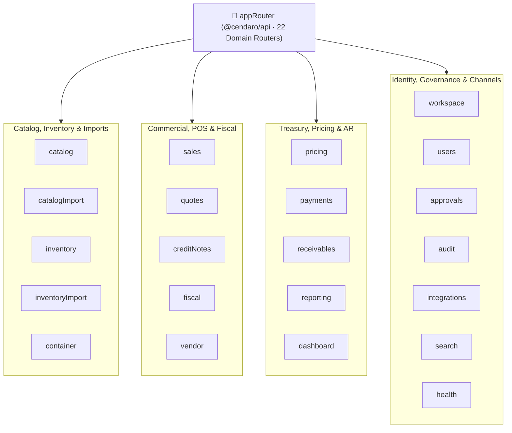

#### Authorization Procedure Builders (`packages/api/src/trpc.ts`)

Every procedure in `@cendaro/api` must be constructed from one of five explicit authorization builders that record `meta.authz`. An automated CI test (`procedure-authz-coverage.test.ts`) fails the build if any procedure omits authorization metadata:

| Builder                                     | Transaction Mode                                | Authorization Contract                                                                                                     |
| :------------------------------------------ | :---------------------------------------------- | :------------------------------------------------------------------------------------------------------------------------- |
| `wsPermissionProcedure(module, action)`     | Read / Write RLS (`runInWorkspaceRls`)          | Verifies active `workspace_member` role against `ROLE_PERMISSIONS[role][module]` and checks `WorkspaceModule` enablement.  |
| `wsReadPermissionProcedure(module, action)` | **Read-Only RLS** (`SET TRANSACTION READ ONLY`) | Enforces read permission while guaranteeing zero accidental writes at the PostgreSQL transaction level (`Postgres 25006`). |
| `memberReadProcedure`                       | **Read-Only RLS** (`SET TRANSACTION READ ONLY`) | Allows any active member of the current workspace to read shared workspace metadata.                                       |
| `selfProcedure`                             | Authenticated User Context                      | Scoped strictly to the authenticated user's own profile, sessions, and workspace memberships.                              |
| `publicHealthProcedure`                     | Public / Unauthenticated                        | Restricted exclusively to `/api/trpc/health` readiness probes.                                                             |

<details>
<summary><strong>📋 Full Router Reference Table (All 22 Routers)</strong></summary>

|  #  | Router            | Source File                                                                   | Domain Responsibility                                                                                                                                                     | Primary Access                   |
| :-: | :---------------- | :---------------------------------------------------------------------------- | :------------------------------------------------------------------------------------------------------------------------------------------------------------------------ | :------------------------------- |
|  1  | `users`           | [`modules/users.ts`](packages/api/src/modules/users.ts)                       | User profiles, role assignment, status lifecycle, GDPR/privacy self-anonymization.                                                                                        | `owner`, `admin`                 |
|  2  | `audit`           | [`modules/audit-router.ts`](packages/api/src/modules/audit-router.ts)         | Immutable event queries, SHA-256 chain verification, signed external audit exports.                                                                                       | `owner`, `admin`                 |
|  3  | `approvals`       | [`modules/approvals.ts`](packages/api/src/modules/approvals.ts)               | Multi-step workflow approvals (discounts, adjustments, credit notes, closures) & digital signatures.                                                                      | `owner`, `admin`, `supervisor`   |
|  4  | `catalog`         | [`modules/catalog.ts`](packages/api/src/modules/catalog.ts)                   | Products, brands, hierarchical categories, suppliers, multi-tier prices, UoM equivalences.                                                                                | Role-based (`catalog`)           |
|  5  | `catalogImport`   | [`modules/catalog-import.ts`](packages/api/src/modules/catalog-import.ts)     | 6-step spreadsheet import wizard: column mapping, row validation, fuzzy category alias resolution, batch commit.                                                          | Role-based (`catalog`)           |
|  6  | `inventory`       | [`modules/inventory.ts`](packages/api/src/modules/inventory.ts)               | Multi-warehouse stock ledger, channel allocations, inter-warehouse transfers, blind cycle counts, Kardex movements.                                                       | Role-based (`inventory`)         |
|  7  | `inventoryImport` | [`modules/inventory-import.ts`](packages/api/src/modules/inventory-import.ts) | Bulk stock initialization, replacement, and delta adjustments via validated Excel sheets.                                                                                 | Role-based (`inventory`)         |
|  8  | `container`       | [`modules/containers.ts`](packages/api/src/modules/containers.ts)             | Maritime import tracking, AI packing list ingestion, landed cost averaging (`costAvg`), warehouse reception.                                                              | `owner`, `admin`, `supervisor`   |
|  9  | `creditNotes`     | [`modules/credit-notes.ts`](packages/api/src/modules/credit-notes.ts)         | Commercial credit notes, admin approval workflow, automatic stock return & AR balance reversal.                                                                           | Role-based (`sales` / `admin`)   |
| 10  | `fiscal`          | [`modules/fiscal.ts`](packages/api/src/modules/fiscal.ts)                     | Venezuelan **SENIAT** compliance engine: `fiscal_document`, IVA, IGTF (3%), tax withholdings, Sales Ledger (_Libro de Ventas_), multi-branch (`legal_entity` / `branch`). | `owner`, `admin`, `supervisor`   |
| 11  | `pricing`         | [`modules/pricing.ts`](packages/api/src/modules/pricing.ts)                   | Exchange rates (BCV, Parallel, CNY), 5% deviation holds, pricing rules, controlled repricing approvals.                                                                   | Role-based (`pricing` / `rates`) |
| 12  | `quotes`          | [`modules/quotes.ts`](packages/api/src/modules/quotes.ts)                     | Customer quotations, expiration handling, idempotent conversion into confirmed sales orders.                                                                              | Role-based (`orders`)            |
| 13  | `sales`           | [`modules/sales.ts`](packages/api/src/modules/sales.ts)                       | Customers, POS checkout, omnichannel orders, delivery notes, internal invoices, blind cash closures.                                                                      | Role-based (`pos` / `orders`)    |
| 14  | `payments`        | [`modules/payments.ts`](packages/api/src/modules/payments.ts)                 | Multi-method payment recording (Pago Móvil, Wire, Zelle, Cash), evidence uploads, payment verification.                                                                   | Role-based (`payments`)          |
| 15  | `receivables`     | [`modules/receivables.ts`](packages/api/src/modules/receivables.ts)           | Accounts receivable ledger, installment schedules, aging analytics, BCV-indexed debt settlement.                                                                          | Role-based (`receivables`)       |
| 16  | `reporting`       | [`modules/reporting.ts`](packages/api/src/modules/reporting.ts)               | Financial, inventory valuation, margin, and commercial performance reports (`/reports`).                                                                                  | `owner`, `admin`, `supervisor`   |
| 17  | `vendor`          | [`modules/vendors.ts`](packages/api/src/modules/vendors.ts)                   | Field sales portal (strictly row-scoped via `vendor-scope.ts`), commission calculation, assigned client AR.                                                               | `vendor` (self-scoped), `admin`  |
| 18  | `integrations`    | [`modules/integrations.ts`](packages/api/src/modules/integrations.ts)         | Mercado Libre OAuth (AES-256-GCM encrypted token vault), listing/order sync, failure retry queue.                                                                         | `owner`, `admin`                 |
| 19  | `dashboard`       | [`modules/dashboard.ts`](packages/api/src/modules/dashboard.ts)               | Executive KPIs, revenue/margin time series, active system alert counters, notification routing.                                                                           | Role-based (`dashboard`)         |
| 20  | `search`          | [`modules/search.ts`](packages/api/src/modules/search.ts)                     | Global low-latency command search across products, customers, orders, quotes, and containers.                                                                             | Authenticated member             |
| 21  | `workspace`       | [`modules/workspace.ts`](packages/api/src/modules/workspace.ts)               | Multi-tenant workspace provisioning, member invitations, seat quotas (`workspace-seats.ts`), module toggles.                                                              | Authenticated / `owner`          |
| 22  | `health`          | [`modules/health/router.ts`](packages/api/src/modules/health/router.ts)       | Database connectivity & system readiness probe.                                                                                                                           | Public                           |

</details>

---

<a id="cendarodb--database--schema"></a>

### `@cendaro/db` — Database & Schema

> **75 PostgreSQL tables**, **37 enums**, and **50 sequential SQL migrations** modeled in Drizzle ORM (`packages/db`). Connects via `pg.Pool` (max 5 connections per serverless instance) through Supabase **Supavisor transaction mode (`:6543`)** to prevent connection exhaustion under high Vercel concurrency.

| Domain Phase                     | Tables Count | PostgreSQL Tables (`packages/db/src/schema.ts`)                                                                                                                                                                                                                                               |
| :------------------------------- | :----------: | :-------------------------------------------------------------------------------------------------------------------------------------------------------------------------------------------------------------------------------------------------------------------------------------------- |
| **1 · Identity & Audit**         |      5       | `organization` · `user_profile` · `permission` · `role_permission` · `audit_log`                                                                                                                                                                                                              |
| **2 · Multi-Tenancy**            |      6       | `workspace` · `workspace_member` · `workspace_module` · `workspace_profile` · `workspace_quota` · `document_sequence`                                                                                                                                                                         |
| **3 · Catalog & Imports**        |      11      | `brand` · `category` · `category_alias` · `supplier` · `product` · `product_attribute` · `product_uom_equivalence` · `product_supplier` · `product_price` · `import_session` · `import_session_row`                                                                                           |
| **4 · Inventory & Containers**   |      12      | `warehouse` · `warehouse_location` · `stock_ledger` · `channel_allocation` · `stock_movement` · `inventory_count` · `inventory_count_item` · `inventory_discrepancy` · `container` · `container_item` · `container_document` · `ai_prompt_config`                                             |
| **5 · Pricing & FX Engine**      |      4       | `exchange_rate` · `price_history` · `pricing_rule` · `repricing_event`                                                                                                                                                                                                                        |
| **6 · Commercial & POS**         |      16      | `customer` · `customer_address` · `sales_order` · `order_item` · `payment` · `payment_evidence` · `payment_allocation` · `cash_closure` · `quote` · `quote_item` · `delivery_note` · `delivery_note_item` · `internal_invoice` · `internal_invoice_item` · `credit_note` · `credit_note_item` |
| **7 · SENIAT Fiscal & Branches** |      3       | `legal_entity` · `branch` · `fiscal_document`                                                                                                                                                                                                                                                 |
| **8 · Vendors & Receivables**    |      3       | `vendor_commission` · `account_receivable` · `ar_installment`                                                                                                                                                                                                                                 |
| **9 · Omnichannel Integrations** |      6       | `ml_listing` · `ml_order` · `integration_log` · `mercadolibre_account` · `mercadolibre_order_event` · `integration_failure`                                                                                                                                                                   |
| **10 · Governance & Alerts**     |      6       | `system_alert` · `approval` · `signature` · `notification_bucket` · `notification_bucket_assignee` · `notification_routing_rule`                                                                                                                                                              |
| **11 · Security & Sessions**     |      3       | `rate_limit_bucket` · `rate_limit_lockout` · `user_session_activity`                                                                                                                                                                                                                          |

---

<a id="cendaroauth--authentication"></a>

### `@cendaro/auth` — Authentication

> Clean runtime separation for Supabase SSR (`@supabase/ssr ^0.12.5`) across Next.js 16 execution contexts.

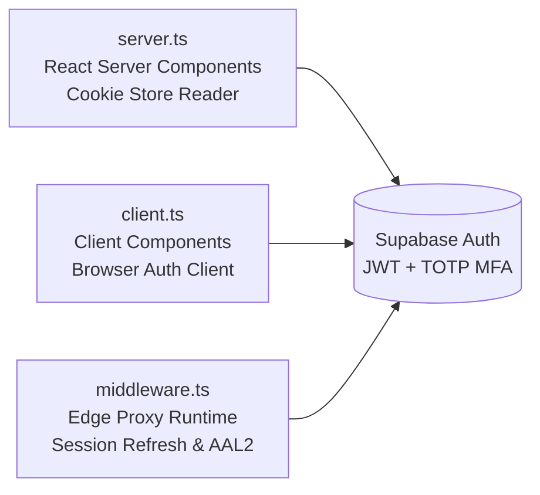

---

<a id="cendaroui--component-library"></a>

### `@cendaro/ui` — Component Library

> Shared 0-radius design system built on **Radix UI** + **shadcn/ui** (`packages/ui`). Zero hex literals—every component consumes semantic CSS custom properties from `@cendaro/tailwind-config/theme`.

| Category                    | Exported Primitives (`packages/ui/src/`)                                                                                                                                                |
| :-------------------------- | :-------------------------------------------------------------------------------------------------------------------------------------------------------------------------------------- |
| **Data Display & Status**   | `Table` · `Card` · `Badge` · `StatusPill` · `Avatar` · `Chart` (Recharts React 19 prop-sanitized) · `AnimatedNumber` · `Skeleton`                                                       |
| **Overlays & Navigation**   | `Dialog` · `Sheet` · `Popover` · `DropdownMenu` · `Tooltip` · `Tabs` · `Separator` · `AnimatedSizeContainer`                                                                            |
| **Form Controls & Actions** | `Button` · `SubmitButton` · `Input` · `Textarea` · `Select` · `Checkbox` · `Switch` · `ToggleGroup` · `Label` · `Spinner`                                                               |
| **Icon System (`./icons`)** | `Icons` & `<Icon name={...} />` — **154 unified vector icons** (33 standard UI glyphs + 121 Material Symbols Outlined `wght300/opsz24` auto-generated via `pnpm -F @cendaro/ui icons`). |

---

<a id="cendarovalidators--domain-validation"></a>

### `@cendaro/validators` — Domain Validation

> Single source of truth for **Zod v4** (`zod/v4`) schemas, Venezuelan fiscal identifiers, monetary precision, subscription plan quotas, and the **18-module × 6-role RBAC permission matrix**.

| Module                 | File                                                 | Key Exports & Invariants                                                                                                                                                                                                             |
| :--------------------- | :--------------------------------------------------- | :----------------------------------------------------------------------------------------------------------------------------------------------------------------------------------------------------------------------------------- |
| **RBAC & Modules**     | [`src/authz.ts`](packages/validators/src/authz.ts)   | `ERP_MODULES` (18 modules), `USER_ROLES` (`owner`, `admin`, `supervisor`, `employee`, `vendor`, `marketing`), `PERMISSION_ACTIONS` (`view`, `create`, `edit`, `delete`, `approve`, `export`), `ROLE_PERMISSIONS`, `hasPermission()`. |
| **Venezuelan Fiscal**  | [`src/fiscal.ts`](packages/validators/src/fiscal.ts) | `seniatRifSchema` (`^[JVGEP]-\d{8}-\d$` with Modulo-11 check digit verification), `cedulaSchema` (`^[VE]-\d{6,8}$`), `phoneSchema`, fiscal document & tax classification validators.                                                 |
| **Monetary Precision** | [`src/money.ts`](packages/validators/src/money.ts)   | `moneySchema` (non-negative, 2 decimal places), `percentageSchema` (`0–100`), integer-cent rounding helpers preventing IEEE 754 floating-point drift.                                                                                |
| **FX & Rate Guards**   | [`src/rates.ts`](packages/validators/src/rates.ts)   | `exchangeRateSchema` (up to 4 decimals), `MAX_AUTOMATIC_RATE_DEVIATION` (`0.05` / **5% preventive hold threshold**).                                                                                                                 |
| **Workspace Plans**    | [`src/plans.ts`](packages/validators/src/plans.ts)   | `WORKSPACE_PLANS` (`starter`, `pro`, `enterprise`), `STARTER_MODULES`, `STARTER_QUOTA` seat and warehouse limits.                                                                                                                    |

<p align="right"><a href="#top">↑ Back to top</a></p>

---

## 🧭 ERP Modules

Cendaro structures its operational surface into **18 canonical permission modules** rendered across **23 authenticated Next.js App Router route groups** (`apps/erp/src/app/(app)/`), complemented by a public **AI Search & Generative Engine Optimization (GEO)** surface (`apps/erp/src/app/(marketing)/`).

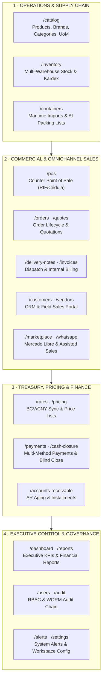

<details>
<summary><strong>📋 Full Authenticated Route Reference (All 23 Routes in <code>apps/erp/src/app/(app)/</code>)</strong></summary>

|  #  | Route                  | Domain Group | Operational Capabilities                                                                                                                       |
| :-: | :--------------------- | :----------- | :--------------------------------------------------------------------------------------------------------------------------------------------- |
|  1  | `/dashboard`           | Control      | Executive KPI cards, USD/Bs revenue & gross margin charts, low-stock counters, quick actions.                                                  |
|  2  | `/catalog`             | Operations   | Product master, brands, categories, suppliers, multi-tier USD prices, UoM equivalences, 6-step Excel import wizard (`/catalog/import`).        |
|  3  | `/inventory`           | Operations   | Multi-warehouse stock ledger, channel allocations, inter-warehouse transfers, blind cycle counts, Excel stock import (`/inventory/import`).    |
|  4  | `/containers`          | Operations   | Maritime container tracking, AI packing list parser (Excel/PDF/images), landed cost averaging (`costAvg`), reception workflow.                 |
|  5  | `/pos`                 | Sales        | Fast counter Point of Sale with barcode scanner, SENIAT RIF/Cédula validation, split USD/Bs payments, and credit note refund checklists.       |
|  6  | `/orders`              | Sales        | Omnichannel sales order lifecycle (`draft` → `confirmed` → `prepared` → `dispatched` → `delivered`), status transitions, WhatsApp share links. |
|  7  | `/quotes`              | Sales        | Commercial quotations with validity windows and one-click idempotent conversion into sales orders.                                             |
|  8  | `/delivery-notes`      | Sales        | Warehouse dispatch notes (_Notas de Entrega_) with line-item verification and recipient confirmation.                                          |
|  9  | `/invoices`            | Sales        | Internal billing documents (_Facturas Internas_) and SENIAT fiscal document integration.                                                       |
| 10  | `/customers`           | Sales        | Customer master registry (`wholesale`, `retail`, `vip`), tax IDs, shipping addresses, credit limits, and order history.                        |
| 11  | `/vendors`             | Sales        | Row-scoped field sales portal: assigned customer portfolio, self-service order placement, commission ledger.                                   |
| 12  | `/rates`               | Finance      | Live BCV, Parallel, and RMB/USD exchange rate desk, spread telemetry, multi-currency calculator, historical rate log.                          |
| 13  | `/pricing`             | Finance      | Margin rules, BCV deviation holds (≥ 5%), controlled repricing events, and immutable price history.                                            |
| 14  | `/payments`            | Finance      | Payment verification hub supporting Pago Móvil, Bank Wire, Zelle, Cash USD/Bs, Biopago, and receipt evidence uploads.                          |
| 15  | `/cash-closure`        | Finance      | Daily blind cash reconciliation (_Cierre de Caja_) verifying cashier declarations against server-computed ledger totals.                       |
| 16  | `/accounts-receivable` | Finance      | Customer debt aging, installment schedules, BCV-indexed partial abonos, and automated ledger reconciliation.                                   |
| 17  | `/reports`             | Control      | Executive analytics: inventory valuation, sales by channel/vendor, gross margin breakdowns, and fiscal exports.                                |
| 18  | `/marketplace`         | Channels     | Mercado Libre OAuth account linking, catalog listing synchronization, and order ingestion.                                                     |
| 19  | `/whatsapp`            | Channels     | Assisted WhatsApp sales workflow with pre-formatted order summaries and payment instructions.                                                  |
| 20  | `/users`               | Control      | Workspace member administration, 6-role RBAC assignment, seat quota tracking, and MFA status visibility.                                       |
| 21  | `/audit`               | Control      | Tamper-evident SHA-256 hash-chained audit trail with cryptographic integrity verification and signed export.                                   |
| 22  | `/alerts`              | Control      | Operational alert center for rate deviations, overdue receivables, and integration sync failures.                                              |
| 23  | `/settings`            | Control      | Workspace profile, fiscal legal entities/branches, module enablement, notification routing buckets, and AI prompt configuration.               |

</details>

### Public Marketing & AI Search (GEO) Surface

In addition to the authenticated ERP, `@cendaro/erp` serves a zero-hallucination public marketing and AI ingestion surface verified by [`content.guard.test.ts`](apps/erp/src/app/_components/landing/content.guard.test.ts):

- **Machine-Readable LLM Knowledge Bases**: Dynamic [`/llms.txt`](apps/erp/src/app/llms.txt/route.ts) and [`/llms-full.txt`](apps/erp/src/app/llms-full.txt/route.ts) endpoints following the `llmstxt.org` v2 specification for zero-noise ingestion by ChatGPT Search (`OAI-SearchBot`), Perplexity (`PerplexityBot`), Claude (`Claude-SearchBot`), and Google Gemini (`Google-Extended`).
- **Connected Schema.org `@graph` JSON-LD**: Linked `Organization`, `WebSite`, `SoftwareApplication`, `ItemList`, `FAQPage`, and `VideoObject` structured data in [`seo.tsx`](apps/erp/src/app/_components/landing/seo.tsx).
- **Instant Search Indexing**: Post-deploy **IndexNow** + Google WebSub + Search Console notification pipeline via [`scripts/seo/ping-indexnow.mjs`](scripts/seo/ping-indexnow.mjs).

<p align="right"><a href="#top">↑ Back to top</a></p>

---

## 🗄 Database Schema

The core domain model in [`packages/db/src/schema.ts`](packages/db/src/schema.ts) enforces strict referential integrity, tenant isolation (`workspace_id`), and double-entry financial/inventory invariants across **75 tables**.

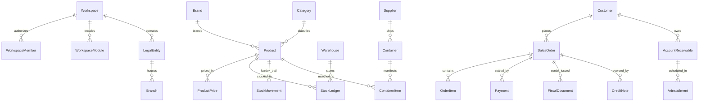

<p align="right"><a href="#top">↑ Back to top</a></p>

---

## 🤖 AI Pipeline

Cendaro's container ingestion engine processes complex, multi-sheet supplier packing lists (up to **130 MB+**) without hitting serverless payload limits by splitting extraction across three specialized tiers:

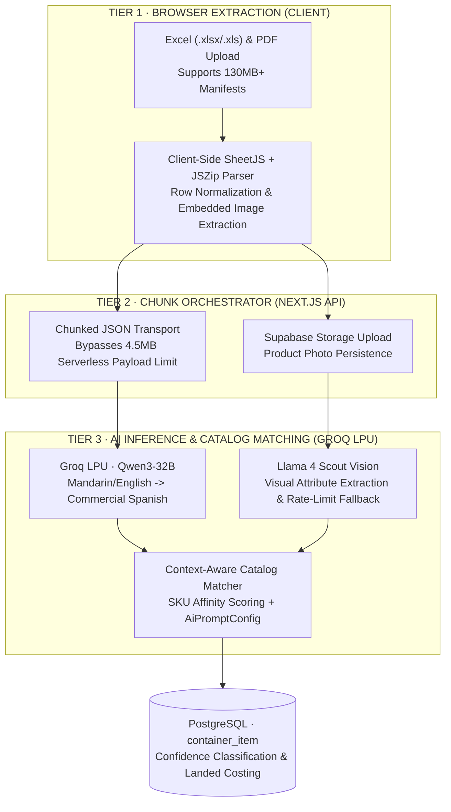

| Stage                    | Component                                 | Engineering Implementation                                                                                                                    |
| :----------------------- | :---------------------------------------- | :-------------------------------------------------------------------------------------------------------------------------------------------- |
| **1. Client Parsing**    | Browser-side SheetJS (`0.20.3`) + `jszip` | Parses massive spreadsheets and extracts embedded cell images in browser memory before network transmission (Rule #9).                        |
| **2. Chunk Transport**   | `/api/ai/parse-packing-list`              | Streams normalized row batches and uploads extracted product photos to Supabase Storage buckets.                                              |
| **3. LLM Translation**   | Groq LPU (`Qwen3-32B`)                    | Translates supplier descriptions (Chinese/English → Venezuelan commercial Spanish) and normalizes units, quantities, and unit costs.          |
| **4. Vision & Fallback** | `Llama 4 Scout`                           | Inspects embedded packing list photos for visual product identification and serves as automatic rate-limit failover.                          |
| **5. Catalog Matching**  | `AiPromptConfig` + Fuzzy Matcher          | Computes confidence scores (`high ≥ 90%`, `medium 60–89%`, `low < 60%`) linking parsed rows to existing `Product` SKUs or flagging new items. |

<p align="right"><a href="#top">↑ Back to top</a></p>

---

## 🔐 Security

Cendaro implements a **7-Layer Defense-in-Depth Security Architecture** audited against OWASP ASVS, SOC 2, and ISO 27001 controls.

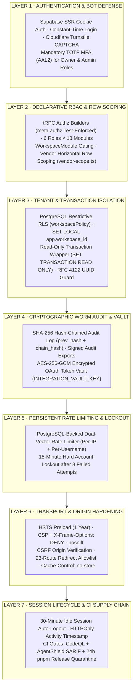

<details>
<summary><strong>📋 Complete 7-Layer Security Controls Matrix</strong></summary>

| Layer  | Control                                     | Implementation Reference                                                                                                                           | Threat Mitigated                                                |
| :----: | :------------------------------------------ | :------------------------------------------------------------------------------------------------------------------------------------------------- | :-------------------------------------------------------------- |
| **L1** | **Supabase Auth SSR & Constant-Time Login** | Dummy `signInWithPassword` execution when username is not found; unified `"Credenciales incorrectas"` response.                                    | Timing oracle & error-based username enumeration.               |
| **L1** | **Cloudflare Turnstile CAPTCHA**            | Server-side `siteverify` validation on `/api/auth/login` when `TURNSTILE_SECRET_KEY` is configured.                                                | Automated credential stuffing & botnet login floods.            |
| **L1** | **Mandatory TOTP MFA (`aal2`)**             | Edge proxy and `mfa-enforcement.ts` verify Authenticator Assurance Level 2 for `owner` and `admin` roles.                                          | Account takeover via phished or leaked passwords.               |
| **L2** | **Test-Enforced tRPC RBAC (`meta.authz`)**  | Every procedure derives from an authz builder checking `ctx.workspace.role` from `workspace_member` (never `user_metadata`).                       | Vertical privilege escalation & unguarded endpoints.            |
| **L2** | **Vendor Horizontal Scoping**               | [`vendor-scope.ts`](packages/api/src/modules/vendor-scope.ts) restricts `vendor` role queries to their own orders, quotes, and assigned customers. | Horizontal data leakage between sales representatives.          |
| **L3** | **PostgreSQL Restrictive RLS**              | `SET LOCAL ROLE app_user` + `SET LOCAL app.workspace_id` inside every transaction with `restrictive` `pgPolicy`.                                   | Cross-tenant data exposure & direct query bypass.               |
| **L3** | **Read-Only Query Enforcement**             | `wsReadPermissionProcedure` wraps queries in `SET TRANSACTION READ ONLY`.                                                                          | Accidental state mutation inside read procedures.               |
| **L4** | **SHA-256 WORM Audit Chain**                | Each `audit_log` row stores `prev_hash` and `chain_hash = SHA256(prev_hash ‖ canonical_payload)`, verified via `verifyAuditChain()`.               | Log tampering, silent record deletion, and repudiation.         |
| **L4** | **AES-256-GCM Integration Vault**           | External OAuth tokens (Mercado Libre) are encrypted at rest using a dedicated `INTEGRATION_VAULT_KEY`.                                             | Plaintext credential exposure in database backups.              |
| **L5** | **PostgreSQL Composite Rate Limiting**      | `rate_limit_bucket` & `rate_limit_lockout` enforce IP (5/60s) + Username (10/15m) limits and a 15-minute lockout after 8 failures.                 | Distributed brute-force attacks across serverless instances.    |
| **L6** | **Strict Transport & Redirect Allowlist**   | HSTS preload, `X-Frame-Options: DENY`, CSRF Origin checks on `/api/auth/*`, and strict allowlist validation on `?redirect=`.                       | Clickjacking, SSL stripping, CSRF, and open-redirect phishing.  |
| **L7** | **Idle Session Timeout & CI Supply Chain**  | 30-minute inactivity auto-logout via `proxy.ts`; CI runs `pnpm audit --prod`, `CodeQL`, and `ecc-agentshield --supply-chain`.                      | Unattended terminal hijacking & malicious dependency injection. |

</details>

<p align="right"><a href="#top">↑ Back to top</a></p>

---

## 🎨 Design System

Cendaro implements a bespoke **0-Radius Monochrome Design System** inspired by **Midday** (`tooling/tailwind/theme.css`). Architectural clarity is achieved through sharp `1px` hairlines, high-contrast typographic hierarchy, and strict restraint: **color is never decorative—it only communicates semantic status or focus**.

### Core Design Rules (Enforced in CI by `design-guard.mjs --phase F9`)

1. **Zero Border Radius (`--radius: 0rem`)**: No `rounded-*` classes are permitted anywhere in application layouts, cards, inputs, dialogs, or buttons. `rounded-full` is reserved exclusively for semantic `StatusPill` / `Badge` chips and user avatars.
2. **Editorial & Tabular Typography (`apps/erp/src/app/layout.tsx`)**:
   - **UI Sans (`--font-hedvig-sans`)**: `Hedvig Letters Sans` (Weight `400`).
   - **Editorial Display (`--font-hedvig-serif`)**: `Hedvig Letters Serif` (Weight `400`).
   - **Tabular Numerals (`--font-geist-mono`)**: `Geist Mono` (`tabular-nums` / `tnum`) for all monetary columns, exchange rates, SKUs, and KPI counters.
   - **Weight Ceiling**: Maximum font weight is `font-medium` (`500`). `font-semibold` and `font-bold` are banned to prevent browser-synthesized faux bold rendering on Hedvig cuts.
3. **Token-Only Color Architecture & WCAG AA Calibration**:
   - Raw hex (`#...`), `rgb(...)`, or Tailwind palette literals (`bg-blue-500`, `text-emerald-600`) are forbidden in `apps/erp/src`.
   - Every status chip resolves through `getStatus(domain, value)` in [`apps/erp/src/lib/status.ts`](apps/erp/src/lib/status.ts) paired with `<StatusPill />`.
   - All foreground/background pairs are mathematically verified for **WCAG AA contrast** in both Light and Dark themes by [`scripts/checks/contrast.mjs`](scripts/checks/contrast.mjs).

### Semantic Surface & Status Tokens (`tooling/tailwind/theme.css`)

| Token Category            | CSS Custom Property               | Light Mode Value                     | Dark Mode Value (`#0C0C0C` Canvas)       | Contrast & Purpose                             |
| :------------------------ | :-------------------------------- | :----------------------------------- | :--------------------------------------- | :--------------------------------------------- |
| **Canvas Surface**        | `--background` / `--surface`      | `hsl(0 0% 100%)` (`#ffffff`)         | `hsl(0 0% 5%)` (`#0c0c0c`)               | Primary application background.                |
| **Elevated Card / Sheet** | `--card` / `--sheet`              | `hsl(45 18% 96%)` / `#fafaf9`        | `hsl(0 0% 7%)` / `#0c0c0c`               | Containers, modals, and side drawers.          |
| **Muted Text**            | `--muted-foreground`              | `hsl(0 0% 38%)` (`6.20:1` AA)        | `hsl(0 0% 53%)` (`#878787`, `5.44:1` AA) | Secondary labels, captions, table headers.     |
| **Hairline Border**       | `--line` / `--border`             | `#e6e6e6`                            | `#1d1d1d`                                | Crisp `1px` structural grid dividers.          |
| **Status: Success**       | `--status-success-fg` / `-bg`     | `#007a3d` on `#ddf1e4`               | `#00c969` on `rgb(0 201 105 / 0.1)`      | Paid, delivered, active, high confidence.      |
| **Status: Warning**       | `--status-warning-fg` / `-bg`     | `#8a6500` on `rgb(255 208 43 / 0.1)` | `#ffd02b` on `rgb(255 208 43 / 0.1)`     | Pending review, partial payment, rate hold.    |
| **Status: Info**          | `--status-info-fg` / `-bg`        | `#1a56c4` on `#ddebff`               | `#4c8dff` on `rgb(31 111 235 / 0.1)`     | In transit, confirmed, informational state.    |
| **Status: Orange**        | `--status-orange-fg` / `-bg`      | `#b4470a` on `#ffedd5`               | `#f97316` on `rgb(249 115 22 / 0.1)`     | Low stock, customs clearance, expiring soon.   |
| **Status: Destructive**   | `--status-destructive-fg` / `-bg` | `#c21f21` on `rgb(255 54 56 / 0.1)`  | `#ff3638` on `rgb(255 54 56 / 0.1)`      | Overdue AR, cancelled, rejected, out of stock. |

<p align="right"><a href="#top">↑ Back to top</a></p>

---

## 🚀 Getting Started

<a id="prerequisites--installation"></a>

### Prerequisites

| Requirement               | Version                              | Notes                                                                                         |
| :------------------------ | :----------------------------------- | :-------------------------------------------------------------------------------------------- |
| **Node.js**               | `>= 22.0.0` (`24.x` LTS recommended) | Matches `engines.node` in [`package.json`](package.json) and CI runtime (`NODE_VERSION: 24`). |
| **pnpm**                  | `10.30.3`                            | Enforced via `packageManager` field (Corepack compatible). Never use `npm`, `yarn`, or `bun`. |
| **PostgreSQL / Supabase** | PostgreSQL `16+`                     | Supabase project with Auth, Storage, and Supavisor connection pooling enabled.                |

### Installation & Local Boot

```bash
# 1. Clone the repository and install workspace dependencies
git clone https://github.com/jesusjosezapata99-jpg/Cendaro.git
cd Cendaro
pnpm install

# 2. Configure local environment variables
cp .env.example .env
# -> Populate DATABASE_URL, NEXT_PUBLIC_SUPABASE_URL, NEXT_PUBLIC_SUPABASE_ANON_KEY, and SUPABASE_SERVICE_ROLE_KEY

# 3. Start the ERP development server (Turbopack)
pnpm dev:erp
```

> [!CAUTION]
> **Database Safety Rule:** Never run `pnpm db:push` against the live production Supabase database. Schema changes in production must always be reviewed and applied through versioned SQL migrations in [`packages/db/migrations/`](packages/db/migrations).

<a id="environment-variables"></a>

### Environment Variables

All environment variables are strictly validated at build and startup time via [`apps/erp/src/env.ts`](apps/erp/src/env.ts) (`@t3-oss/env-nextjs` + `zod/v4`):

| Variable                               |      Scope      | Required | Description                                                                                 |
| :------------------------------------- | :-------------: | :------: | :------------------------------------------------------------------------------------------ |
| `DATABASE_URL`                         |     Server      |    ✅    | PostgreSQL connection URL (automatically routed via Supavisor `:6543` transaction pooler).  |
| `NEXT_PUBLIC_SUPABASE_URL`             | Client / Server |    ✅    | Supabase project base URL.                                                                  |
| `NEXT_PUBLIC_SUPABASE_ANON_KEY`        | Client / Server |    ✅    | Supabase public anonymous API key.                                                          |
| `SUPABASE_SERVICE_ROLE_KEY`            |   Server Only   |    ✅    | Supabase service-role secret key (strictly isolated to server modules).                     |
| `GROQ_API_KEY`                         |   Server Only   | Optional | Groq LPU API key for AI packing list parsing (`Qwen3-32B` / `Llama 4 Scout`).               |
| `EXCHANGE_RATE_API_KEY`                |   Server Only   | Optional | Fallback API key for USD/CNY rate synchronization.                                          |
| `CRON_SECRET`                          |   Server Only   | Optional | Bearer secret (≥ 32 chars) authenticating Vercel Cron jobs (`/api/cron/*`).                 |
| `MFA_ENFORCEMENT_DATE`                 |   Server Only   | Optional | ISO UTC cutover date (`YYYY-MM-DD`) enforcing mandatory TOTP MFA for `owner`/`admin`.       |
| `INTEGRATION_VAULT_KEY`                |   Server Only   | Optional | 32+ character key for `AES-256-GCM` encryption of external OAuth tokens at rest.            |
| `MERCADOLIBRE_APP_ID`                  |   Server Only   | Optional | Mercado Libre OAuth application client ID.                                                  |
| `MERCADOLIBRE_SECRET`                  |   Server Only   | Optional | Mercado Libre OAuth client secret.                                                          |
| `TURNSTILE_SECRET_KEY`                 |   Server Only   | Optional | Cloudflare Turnstile server secret key for `/api/auth/login` bot verification.              |
| `NEXT_PUBLIC_TURNSTILE_SITE_KEY`       |     Client      | Optional | Cloudflare Turnstile public widget site key.                                                |
| `NEXT_PUBLIC_SENTRY_DSN`               | Client / Server | Optional | Sentry DSN for client, server, and edge error reporting.                                    |
| `NEXT_PUBLIC_SITE_URL`                 | Client / Server | Optional | Canonical public origin for SEO metadata, sitemaps, JSON-LD, and `/llms.txt`.               |
| `NEXT_PUBLIC_CONTACT_WHATSAPP`         |     Client      | Optional | International WhatsApp digits (e.g. `584141234567`) for access requests on the public site. |
| `NEXT_PUBLIC_CONTACT_EMAIL`            |     Client      | Optional | Contact email address for commercial onboarding requests.                                   |
| `NEXT_PUBLIC_GOOGLE_SITE_VERIFICATION` |     Client      | Optional | Google Search Console verification meta token.                                              |

---

## 📜 Scripts

Run all commands from the repository root using `pnpm`:

| Category                     | Command                                           | Description                                                                                 |
| :--------------------------- | :------------------------------------------------ | :------------------------------------------------------------------------------------------ |
| **Development**              | `pnpm dev:erp`                                    | Start the `@cendaro/erp` Next.js 16 Turbopack server and its workspace dependencies.        |
| **Development**              | `pnpm dev`                                        | Run `graphify watch .` and start all monorepo packages in watch mode.                       |
| **Build**                    | `pnpm build`                                      | Execute a full production build across all packages via Turborepo (`turbo run build`).      |
| **Quality Gate**             | `pnpm typecheck`                                  | Run strict TypeScript verification (`tsc --noEmit`) across all workspaces.                  |
| **Quality Gate**             | `pnpm lint` / `pnpm lint:fix`                     | Run ESLint 10 flat-config linting with cache across all packages.                           |
| **Quality Gate**             | `pnpm format` / `pnpm format:fix`                 | Check or auto-format all files with Prettier 3.9.                                           |
| **Quality Gate**             | `pnpm lint:ws`                                    | Validate monorepo `package.json` consistency and dependency catalog alignment via `sherif`. |
| **Testing**                  | `pnpm test`                                       | Execute all Vitest unit, integration, RBAC coverage, and content truth-guard suites.        |
| **Design & Security Guards** | `node scripts/checks/design-guard.mjs --phase F9` | Verify 0-radius rules, font-weight ceiling, token-only colors, and icon imports.            |
| **Design & Security Guards** | `node scripts/checks/contrast.mjs`                | Mathematically validate WCAG AA contrast ratios for all theme tokens in Light & Dark modes. |
| **Design & Security Guards** | `node scripts/checks/role-matrix-audit.mjs`       | Verify UI route access rules against backend `ROLE_PERMISSIONS`.                            |
| **Design & Security Guards** | `pnpm security:agents:gate`                       | Run `ecc-agentshield` SOC2/ISO compliance & supply-chain security gate against baseline.    |
| **Database**                 | `pnpm db:generate`                                | Generate SQL migration files from Drizzle schema changes (`@cendaro/db`).                   |
| **Database**                 | `pnpm db:studio`                                  | Launch Drizzle Studio GUI to inspect the database schema and records.                       |
| **UI & SEO**                 | `pnpm ui-add`                                     | Add a new component primitive to `@cendaro/ui`.                                             |
| **UI & SEO**                 | `pnpm seo:ping`                                   | Ping IndexNow, Google WebSub, and Search Console after production deployments.              |

<p align="right"><a href="#top">↑ Back to top</a></p>

---

## 🗺 Roadmap

| Phase  | Architectural Milestone                                                                                                                                                                            |    Status    |
| :----: | :------------------------------------------------------------------------------------------------------------------------------------------------------------------------------------------------- | :----------: |
| **0**  | Monorepo foundation (`pnpm` + Turborepo), strict TypeScript 5.9, ESLint 10, Tailwind CSS v4.                                                                                                       | ✅ Completed |
| **1**  | Core identity schema, 6-role RBAC permission matrix, and immutable `audit_log` foundation.                                                                                                         | ✅ Completed |
| **2**  | Product catalog, multi-warehouse inventory ledger, maritime containers, and 3-tier AI packing list pipeline.                                                                                       | ✅ Completed |
| **3**  | Multi-currency pricing engine, automated BCV / CNY exchange rate sync, and ≥ 5% deviation holds.                                                                                                   | ✅ Completed |
| **4**  | Omnichannel sales orders, POS checkout, quotes, delivery notes, internal invoices, and blind cash closures.                                                                                        | ✅ Completed |
| **5**  | Mercado Libre OAuth integration (AES-256-GCM vault) and assisted WhatsApp commerce workflows.                                                                                                      | ✅ Completed |
| **6**  | Executive KPI dashboard, row-scoped field vendor portal, commissions, and accounts receivable aging.                                                                                               | ✅ Completed |
| **7**  | 7-layer security hardening: mandatory MFA (`aal2`), Cloudflare Turnstile, PostgreSQL rate limiting, and CSRF/HSTS guards.                                                                          | ✅ Completed |
| **8**  | Midday 0-Radius Monochrome Design System overhaul (`Hedvig Letters` + `Geist Mono`) & WCAG AA contrast certification.                                                                              | ✅ Completed |
| **9**  | Multi-tenancy (`workspace` isolation), Restrictive PostgreSQL RLS, and read-only transaction wrappers.                                                                                             | ✅ Completed |
| **10** | PRD v2.0 Enterprise Expansion: Credit notes (`credit_note`), SENIAT fiscal engine (`fiscal_document`), multi-branch (`legal_entity` / `branch`), and SHA-256 hash-chained WORM audit verification. | ✅ Completed |
| **11** | Generative Engine Optimization (GEO): `/llms.txt`, `/llms-full.txt`, connected `@graph` JSON-LD, HiDPI dual-theme media pipeline, and IndexNow automation.                                         | ✅ Completed |

<p align="right"><a href="#top">↑ Back to top</a></p>

---

## 📄 Documentation

> [!IMPORTANT]
> **Canonical Specification Package:** The [`docs/`](docs/README.md) directory is the authoritative specification source for Cendaro ERP. Architectural and execution plans reside in [`plans/`](plans/README.md).

### Product, Architecture & Data Specifications

| Document                                     | Path                                                                                                                 |   Status    |
| :------------------------------------------- | :------------------------------------------------------------------------------------------------------------------- | :---------: |
| **PRD v2.0 — Production & Market Expansion** | [`docs/product/PRD_v2.0_Produccion_y_Mercado.md`](docs/product/PRD_v2.0_Produccion_y_Mercado.md)                     |  ✅ Active  |
| **PRD v1.0 — Core Omnichannel ERP**          | [`docs/product/PRD_v1.0.md`](docs/product/PRD_v1.0.md)                                                               |  ✅ Active  |
| **Feature PRD — Catalog Import Wizard**      | [`docs/product/features/FEATURE_PRD_CATALOG_IMPORT.md`](docs/product/features/FEATURE_PRD_CATALOG_IMPORT.md)         |  ✅ Active  |
| **Feature PRD — Inventory Import Wizard**    | [`docs/product/features/FEATURE_PRD_INVENTORY_IMPORT.md`](docs/product/features/FEATURE_PRD_INVENTORY_IMPORT.md)     |  ✅ Active  |
| **Feature PRD — Spreadsheet Import Engine**  | [`docs/product/features/FEATURE_PRD_SPREADSHEET_IMPORT.md`](docs/product/features/FEATURE_PRD_SPREADSHEET_IMPORT.md) |  ✅ Active  |
| **ERD & Schema Blueprint v1**                | [`docs/architecture/erd_schema_blueprint_v1.md`](docs/architecture/erd_schema_blueprint_v1.md)                       |  ✅ Active  |
| **Module & API Blueprint v1**                | [`docs/architecture/module_api_blueprint_v1.md`](docs/architecture/module_api_blueprint_v1.md)                       |  ✅ Active  |
| **Multi-Tenant RLS Architecture**            | [`docs/architecture/multi-tenant-architecture.md`](docs/architecture/multi-tenant-architecture.md)                   |  ✅ Active  |
| **DBML Schema Specification**                | [`docs/data/erp_schema_v1.dbml`](docs/data/erp_schema_v1.dbml)                                                       |  ✅ Active  |
| **Schema Alignment Report**                  | [`docs/data/SCHEMA_ALIGNMENT.md`](docs/data/SCHEMA_ALIGNMENT.md)                                                     |  ✅ Active  |
| **ADR-001 — ERP v1.0 Source of Truth**       | [`docs/adr/001-erp-v1-source-of-truth.md`](docs/adr/001-erp-v1-source-of-truth.md)                                   | ✅ Accepted |
| **ADR-002 — PRD v2.0 Production Roadmap**    | [`docs/adr/002-prd-v2-production-roadmap.md`](docs/adr/002-prd-v2-production-roadmap.md)                             | ✅ Accepted |

### Security Runbooks & Compliance Policies (SOC 2 / ISO 27001 Alignment)

| Document                                          | Path                                                                                                                                 |  Status   |
| :------------------------------------------------ | :----------------------------------------------------------------------------------------------------------------------------------- | :-------: |
| **01 · Information Security Policy**              | [`docs/compliance/01-INFORMATION-SECURITY-POLICY.md`](docs/compliance/01-INFORMATION-SECURITY-POLICY.md)                             | ✅ Active |
| **02 · Access Control & MFA Policy**              | [`docs/compliance/02-ACCESS-CONTROL-AND-MFA-POLICY.md`](docs/compliance/02-ACCESS-CONTROL-AND-MFA-POLICY.md)                         | ✅ Active |
| **03 · Incident Management & Response**           | [`docs/compliance/03-INCIDENT-MANAGEMENT-AND-RESPONSE.md`](docs/compliance/03-INCIDENT-MANAGEMENT-AND-RESPONSE.md)                   | ✅ Active |
| **04 · Business Continuity & Disaster Recovery**  | [`docs/compliance/04-BUSINESS-CONTINUITY-AND-DISASTER-RECOVERY.md`](docs/compliance/04-BUSINESS-CONTINUITY-AND-DISASTER-RECOVERY.md) | ✅ Active |
| **05 · Data Classification, Retention & Privacy** | [`docs/compliance/05-DATA-CLASSIFICATION-RETENTION-PRIVACY.md`](docs/compliance/05-DATA-CLASSIFICATION-RETENTION-PRIVACY.md)         | ✅ Active |
| **06 · Secure SDLC & Change Management**          | [`docs/compliance/06-SECURE-SDLC-AND-CHANGE-MANAGEMENT.md`](docs/compliance/06-SECURE-SDLC-AND-CHANGE-MANAGEMENT.md)                 | ✅ Active |
| **Incident Response Runbook**                     | [`docs/security/INCIDENT_RESPONSE.md`](docs/security/INCIDENT_RESPONSE.md)                                                           | ✅ Active |
| **WAF & Secrets Rotation Runbook**                | [`docs/security/waf-and-secrets-runbook.md`](docs/security/waf-and-secrets-runbook.md)                                               | ✅ Active |

---

## ⚖️ License

Cendaro ERP is open-source software licensed under the **[GNU Affero General Public License v3.0 (AGPL-3.0)](LICENSE)**.

Any party that modifies and distributes this software—or operates it as a network-accessible service—must make the complete corresponding source code available under the same license terms. For commercial licensing inquiries or enterprise deployment agreements, please contact the repository maintainers.

<br/>

<p align="right"><a href="#top">↑ Back to top</a></p>

---

<p align="center">
  <sub><strong>Cendaro ERP</strong> © 2026 — Engineered with precision for wholesale &amp; retail commerce.</sub>
</p>
